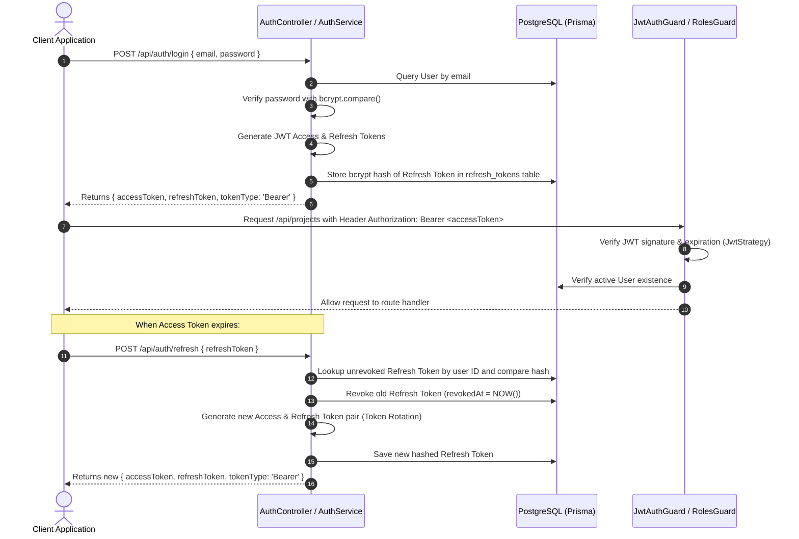

# Enterprise Project Management Platform Backend API

A production-ready, enterprise-grade project management backend built with **NestJS**, **Prisma ORM**, **PostgreSQL**, **Redis**, and **Socket.IO**. 

This system provides hierarchical multi-tenancy (Organizations &rarr; Projects &rarr; Tasks / Issues / Milestones), multi-layer Role-Based Access Control (RBAC), bi-directional real-time collaboration, resilient caching with graceful fallback, atomic sliding-window rate limiting, automated deadline monitoring, time tracking with approval workflows, and audit logging with sensitive data sanitization.

---

## Table of Contents

1. [Project Overview](#project-overview)
2. [Key Features & Highlights](#key-features--highlights)
3. [Technology Stack & Dependencies](#technology-stack--dependencies)
4. [Architecture & Folder Structure](#architecture--folder-structure)
5. [Database Architecture & Data Models](#database-architecture--data-models)
6. [Environment Variables](#environment-variables)
7. [Installation & Setup Instructions](#installation--setup-instructions)
8. [Steps to Run the Application](#steps-to-run-the-application)
9. [Authentication & Authorization Flow](#authentication--authorization-flow)
10. [Redis Caching, Rate Limiting & Resilience](#redis-caching-rate-limiting--resilience)
11. [Real-Time WebSocket Architecture (Socket.IO)](#real-time-websocket-architecture-socketio)
12. [API Documentation](#api-documentation)
    - [System & Health Endpoints](#1-system--health)
    - [Authentication Module](#2-authentication)
    - [Users Module](#3-users)
    - [Organizations Module](#4-organizations)
    - [Projects Module](#5-projects)
    - [Tasks Module](#6-tasks)
    - [Issues Module](#7-issues)
    - [Milestones Module](#8-milestones)
    - [Comments Module](#9-comments)
    - [Time Tracking Module](#10-time-tracking)
    - [Analytics Module](#11-analytics)
    - [Notifications Module](#12-notifications)
    - [Audit Logs Module](#13-audit-logs)
13. [End-to-End Business Workflows](#end-to-end-business-workflows)
14. [Testing, Linting & Real-Time Demo](#testing-linting--real-time-demo)

---

## Project Overview

The **Project Management Platform** is architected to support agile teams collaborating in fast-paced software development environments. It models a clean multi-tenant tree:

```
Organization
 └── Project
      ├── Tasks (with assignment, history tracking, soft delete)
      ├── Issues (with severity, priority, triage workflow, soft delete)
      ├── Milestones (with task linking and completion metrics)
      ├── Comments (polymorphic across Tasks and Issues)
      └── Time Entries (with daily/weekly timesheets and manager approval)
```

The system is engineered for resilience and high throughput:
- **Resilient Redis Client**: Automatically degrades to direct PostgreSQL queries if Redis is offline without dropping user requests.
- **Lua Script Rate Limiting**: Emits standard rate-limit headers (`X-RateLimit-*`) and protects authentication, reporting, and list endpoints.
- **Bi-directional WebSockets**: Delivers immediate state updates and user notifications with acknowledgment IDs (`clientMutationId`).
- **Comprehensive Audit Trail**: Automatically records changes to entities and redacts sensitive credentials/tokens before persistence.

---

## Key Features & Highlights

- **Multi-Tenant Organizations**: Workspaces with independent membership, ownership, and role assignments (`ADMIN`, `PROJECT_MANAGER`, `TEAM_LEAD`, `DEVELOPER`, `VIEWER`).
- **Project Governance**: Project lifecycles (`PLANNED`, `ACTIVE`, `ON_HOLD`, `COMPLETED`, `ARCHIVED`), member scoping, and role enforcement.
- **Task Management**: Prioritized tasks (`LOW`, `MEDIUM`, `HIGH`, `CRITICAL`), soft deletes (`deletedAt`), historical state tracking (`TaskHistory`), and assignees.
- **Issue Tracking**: Bugs and defect workflows with severity ratings (`LOW`, `MEDIUM`, `HIGH`, `CRITICAL`), resolution states, and audit trails.
- **Milestones & Progress Metrics**: Milestones linked to tasks, calculating dynamic completion percentages and overdue days.
- **Polymorphic Comments**: Comments on tasks or issues with real-time room broadcasts.
- **Time Tracking & Timesheet Approvals**: Log daily task hours (max 24h/day cap), view Monday–Sunday weekly breakdowns, submit timesheets, recall drafts, and enable PM/Lead approval or rejection.
- **Project Analytics & Workload Classification**: Cached dashboard metrics and algorithmic team workload status (`LIGHT`, `BALANCED`, `OVERLOADED`).
- **Automated Deadline Notifications**: Background hourly cron checking impending deadlines (&lt;24h) and overdue items, dispatching alerts via WebSockets.
- **Dual-Token Authentication**: JWT access and refresh token rotation with bcrypt-hashed refresh tokens stored in the database.
- **Enterprise Audit Logs**: Complete system action tracking with automated redaction of sensitive credentials (`password`, `token`, `secret`, `jwt`).

---

## Technology Stack & Dependencies

### Core Framework & Runtime
- **Node.js** (Target `ES2023`, NodeNext module resolution)
- **TypeScript** `^6.0.2`
- **NestJS** `^12.0.1` (`@nestjs/core`, `@nestjs/common`, `@nestjs/platform-express`)
- **Express** `^5.0.0`

### Persistence & Data Layer
- **PostgreSQL**: Primary relational database.
- **Prisma Client & CLI** `^6.19.3`: Database schema modeling, type generation, migrations, and transactions.
- **prisma.config.ts**: Prisma v6 configuration.

### Caching, Rate Limiting & Messaging
- **ioredis** `^6.0.0`: Resilient Redis client with connection pooling, retry strategies, and custom Lua scripting.
- **@nestjs/event-emitter** `^12.0.1`: Internal decoupled application events.

### Real-Time Communication
- **Socket.IO** `^4.8.4`: WebSocket server engine.
- **@nestjs/platform-socket.io** & **@nestjs/websockets** `^12.1.2`: NestJS WebSocket gateway integration.
- **socket.io-client** `^4.8.4`: Client harness for automated end-to-end multi-client real-time testing.

### Security, Authentication & Cryptography
- **Passport & Passport JWT** (`passport` `^0.7.0`, `passport-jwt` `^4.0.1`, `@nestjs/passport` `^12.0.0`)
- **@nestjs/jwt** `^12.0.2`: Signing, verifying, and decoding access and refresh tokens.
- **bcrypt** `^6.0.0` (`@types/bcrypt` `^6.0.0`): Hashing passwords and token hashes with 12 salt rounds.
- **Node crypto**: Cryptographic token generation (`randomBytes`, `randomUUID`).

### Validation & Serialization
- **class-validator** `^0.15.1`: Decorator-based DTO request body and query validation.
- **class-transformer** `^0.5.1`: Type-casting and object transformation.

### Testing & Code Quality
- **Jest** `^30.0.0` & **ts-jest** `^29.4.0`: Unit and E2E testing framework.
- **Supertest** `^7.3.1`: HTTP integration assertions.
- **oxlint** `^1.58.0` & **oxlint-tsgolint**: High-speed Rust-based TypeScript linter.
- **Prettier** `^3.4.2`: Code formatting.

---

## Architecture & Folder Structure

```
project-management/
├── prisma/
│   ├── schema.prisma              # Database schema (12 models, 10 enums, indexes, relations)
│   └── migrations/               # Prisma SQL migration history
├── src/
│   ├── app.controller.ts          # System health and root status endpoints (/api, /api/health)
│   ├── app.module.ts              # Root application module orchestrating all feature modules
│   ├── main.ts                    # Application bootstrap, validation pipes, filters, interceptors
│   │
│   ├── common/                    # Shared infrastructure and cross-cutting components
│   │   ├── constants/             # Token types and common auth constants
│   │   ├── decorators/            # @CurrentUser, @Roles, @RateLimit, @OrganizationId, @ProjectId
│   │   ├── filters/               # HttpExceptionFilter (standardized error payload formatting)
│   │   ├── guards/                # RateLimitGuard (Redis-backed), RolesGuard (System roles)
│   │   ├── interceptors/          # LoggingInterceptor (request duration & route logging)
│   │   ├── redis/                 # RedisService (resilient client), CacheInvalidationService
│   │   └── index.ts
│   │
│   ├── config/
│   │   └── configuration.ts       # Centralized typed configuration loader from process.env
│   │
│   ├── database/
│   │   ├── prisma.module.ts       # Global Prisma module provider
│   │   └── prisma.service.ts      # Prisma client lifecycle and shutdown hooks
│   │
│   ├── helpers/
│   │   ├── pagination.helper.ts   # buildPaginatedResponse() standardized output builder
│   │   ├── prisma-select.helper.ts# Reusable Prisma user projection selections
│   │   ├── project-access.helper.ts# assertProjectAssignee() verification helper
│   │   └── index.ts
│   │
│   ├── modules/                   # 13 Domain Feature Modules
│   │   ├── analytics/             # Project dashboards, workload status, and metric aggregations
│   │   ├── audit-logs/            # Audit logging, sanitization of sensitive metadata, activity views
│   │   ├── auth/                  # Register, login, refresh rotation, logout, forgot/reset password
│   │   ├── comments/              # Polymorphic comments on Tasks/Issues with combined history
│   │   ├── issues/                # Bug tracking, status changes, assignments, soft delete
│   │   ├── milestones/            # Project milestones, task linkage, overdue and completion metrics
│   │   ├── notifications/         # Notification inbox, hourly deadline cron, real-time dispatch
│   │   ├── organizations/         # Multi-tenant workspace management, memberships, role updates
│   │   ├── projects/              # Projects, archiving/unarchiving, membership management
│   │   ├── tasks/                 # Task CRUD, assignments, status transitions, soft deletes
│   │   ├── time-tracking/         # Daily & weekly timesheets, submission & PM approval workflow
│   │   ├── users/                 # User profiles and email uniqueness checks
│   │   └── websockets/            # Socket.IO Gateway, room routing, real-time event broadcasting
│   │
│   └── utils/
│       ├── crypto.util.ts         # Bcrypt hash and compare utilities
│       ├── date.util.ts           # Week range (Monday-Sunday), overdue calculations, date validation
│       ├── pagination.util.ts     # Offset calculation, total page computation, pagination metadata
│       ├── string.util.ts         # Bearer token extractor, email sanitizer, UUID & token generators
│       └── index.ts
│
├── test/                          # Testing & Verification Suites
│   ├── app.e2e-spec.ts            # Root API E2E test
│   ├── client-a.ts                # Standalone WebSocket client simulation (Project Manager)
│   ├── client-b.ts                # Standalone WebSocket client simulation (Developer)
│   ├── run-clients-demo.ts        # Automated live 2-client collaborative real-time demo runner
│   ├── ws-clients.e2e-spec.ts     # Multi-client real-time WebSocket E2E test suite
│   └── jest-e2e.json              # E2E test runner configuration
│
├── .env.example                   # Environment variable template
├── nest-cli.json                  # NestJS CLI configuration
├── package.json                   # Dependencies, build scripts, and test definitions
├── prisma.config.ts               # Prisma v6 configuration
├── tsconfig.json                  # TypeScript configuration
└── README.md                      # Comprehensive project documentation
```

---

## Database Architecture & Data Models

The database schema is managed via **Prisma ORM** connecting to **PostgreSQL**.

### Enums

| Enum | Allowed Values | Description |
| :--- | :--- | :--- |
| `UserRole` | `ADMIN`, `PROJECT_MANAGER`, `TEAM_LEAD`, `DEVELOPER`, `VIEWER` | System-wide global user role |
| `UserStatus` | `ACTIVE`, `INACTIVE`, `SUSPENDED` | Account operational state |
| `OrganizationRole` | `ADMIN`, `PROJECT_MANAGER`, `TEAM_LEAD`, `DEVELOPER`, `VIEWER` | Role within an organization workspace |
| `ProjectRole` | `PROJECT_MANAGER`, `TEAM_LEAD`, `DEVELOPER`, `VIEWER` | Role scoped to a specific project |
| `ProjectStatus` | `PLANNED`, `ACTIVE`, `ON_HOLD`, `COMPLETED`, `ARCHIVED` | Project lifecycle status |
| `TaskStatus` | `TODO`, `IN_PROGRESS`, `IN_REVIEW`, `BLOCKED`, `DONE`, `CANCELLED` | Task workflow status |
| `TaskPriority` | `LOW`, `MEDIUM`, `HIGH`, `CRITICAL` | Task urgency level |
| `IssueSeverity` | `LOW`, `MEDIUM`, `HIGH`, `CRITICAL` | Defect technical impact |
| `IssuePriority` | `LOW`, `MEDIUM`, `HIGH`, `URGENT` | Issue resolution priority |
| `IssueStatus` | `OPEN`, `IN_PROGRESS`, `IN_REVIEW`, `RESOLVED`, `CLOSED`, `REOPENED` | Issue lifecycle status |
| `MilestoneStatus` | `PLANNED`, `IN_PROGRESS`, `COMPLETED`, `OVERDUE`, `CANCELLED` | Milestone progress status |
| `TimesheetStatus` | `DRAFT`, `SUBMITTED`, `APPROVED`, `REJECTED` | Time entry workflow state |
| `NotificationType`| `TASK_ASSIGNED`, `ISSUE_ASSIGNED`, `DEADLINE_APPROACHING`, `TASK_COMPLETED`, `ISSUE_UPDATED`, `TIMESHEET_SUBMITTED`, `TIMESHEET_APPROVED`, `SYSTEM` | Notification classification |
| `AuditAction` | `CREATE`, `UPDATE`, `DELETE`, `ASSIGN`, `UNASSIGN`, `STATUS_CHANGE`, `LOGIN`, `LOGOUT`, `PASSWORD_RESET`, `APPROVE`, `REJECT` | Audited system action |
| `CommentEntityType`| `TASK`, `ISSUE` | Polymorphic comment target |

### Models & Entity Relationships

- **`User` (`users`)**: Primary user entity. Has UUID PK, unique email, hashed password, global role, and status. Has relations to organizations, projects, assigned tasks, reported/assigned issues, comments, time entries, notifications, refresh tokens, and password reset tokens.
- **`Organization` (`organizations`)**: Workspace entity. Created by a user. Cascades to `OrganizationMember` and `Project`.
- **`OrganizationMember` (`organization_members`)**: Composite PK `[organizationId, userId]`. Contains member role and join date.
- **`Project` (`projects`)**: Belongs to an organization and user creator. Has status, start/end dates, and optional `archivedAt`. Cascades to members, tasks, issues, and milestones.
- **`ProjectMember` (`project_members`)**: Composite PK `[projectId, userId]`. Associates users with a project-specific role.
- **`Task` (`tasks`)**: Represents actionable work items. Scoped to a project. Has optional assignee, due date, completion timestamp, and soft-delete field (`deletedAt`).
- **`TaskHistory` (`task_history`)**: Immutable log of changes to a task, storing actor userId, action, oldValue (JSON), and newValue (JSON).
- **`Issue` (`issues`)**: Project defect or issue. Stores reporter, optional assignee, severity, priority, status, resolved date, and soft-delete field (`deletedAt`).
- **`IssueHistory` (`issue_history`)**: Immutable log of changes to an issue (status transitions, reassignments).
- **`Milestone` (`milestones`)**: Project delivery targets with start date, due date, and status.
- **`MilestoneTask` (`milestone_tasks`)**: Many-to-many join table between `Milestone` and `Task`.
- **`Comment` (`comments`)**: Polymorphic discussion entity linked to either a Task (`taskId`) or an Issue (`issueId`).
- **`TimeEntry` (`time_entries`)**: Tracks billable/working hours (Decimal `8, 2`) against a task and work date. Features timesheet status (`DRAFT`, `SUBMITTED`, `APPROVED`, `REJECTED`) and approval references.
- **`Notification` (`notifications`)**: Stores user alerts with unread/read state (`readAt`) and metadata payloads.
- **`AuditLog` (`audit_logs`)**: Central enterprise audit trail storing actor ID, action, target entity type, entity ID, and sanitized metadata.
- **`RefreshToken` (`refresh_tokens`)**: Stores bcrypt-hashed JWT refresh tokens with expiration and revocation timestamps.
- **`PasswordResetToken` (`password_reset_tokens`)**: Stores bcrypt-hashed secure tokens for password resets with expiration and usage timestamps.

---

## Environment Variables

All application settings are parsed and validated through `src/config/configuration.ts`. Copy `.env.example` to `.env` and configure accordingly:

| Variable Name | Type | Default Value | Description |
| :--- | :--- | :--- | :--- |
| `NODE_ENV` | `string` | `development` | Runtime environment (`development`, `production`, `test`) |
| `PORT` | `number` | `3000` | HTTP and WebSocket server listening port |
| `DATABASE_URL` | `string` | *(Required)* | PostgreSQL connection string with schema parameter |
| `JWT_ACCESS_SECRET` | `string` | *(Required)* | Cryptographic secret for signing JWT access tokens |
| `JWT_REFRESH_SECRET` | `string` | *(Required)* | Cryptographic secret for signing JWT refresh tokens |
| `JWT_ACCESS_EXPIRES_IN` | `string` | `7d` | Access token lifespan (e.g., `15m`, `1h`, `7d`) |
| `JWT_REFRESH_EXPIRES_IN` | `string` | `7d` | Refresh token lifespan (e.g., `7d`, `30d`) |
| `PASSWORD_RESET_EXPIRES_IN_MINUTES` | `number` | `30` | Password reset token expiration window in minutes |
| `REDIS_URL` | `string` | `redis://localhost:6379` | Redis connection URL |
| `CACHE_TTL_DEFAULT` | `number` | `300` | Default cache TTL in seconds (5 minutes) |
| `CACHE_TTL_DASHBOARD` | `number` | `300` | Analytics project dashboard cache TTL in seconds |
| `CACHE_TTL_REPORTS` | `number` | `600` | Analytical and summary reports cache TTL in seconds (10 minutes) |
| `RATE_LIMIT_WINDOW` | `number` | `60` | Default sliding-window duration in seconds for rate limiter |
| `RATE_LIMIT_AUTH_MAX` | `number` | `5` | Maximum requests permitted per window on sensitive auth endpoints |
| `RATE_LIMIT_REPORTS_MAX`| `number` | `30` | Maximum requests permitted per window on analytics/report endpoints |

---

## Installation & Setup Instructions

### Prerequisites
- **Node.js**: v18+ (v20+ recommended)
- **PostgreSQL**: v14+ running locally or in Docker
- **Redis**: v6+ running locally or in Docker
- **npm** or **yarn**

### 1. Clone & Install Dependencies
```bash
# Clone the repository
git clone <repository-url>
cd project-management

# Install npm packages
npm install
```

### 2. Configure Environment
```bash
# Duplicate the example environment file
cp .env.example .env

# Edit .env and supply your PostgreSQL credentials and JWT secrets
```

### 3. Database Initialization & Prisma Migrations
Generate Prisma client artifacts and run schema migrations against PostgreSQL:
```bash
# Generate the Prisma Client
npx prisma generate

# Apply migrations to the database
npx prisma migrate dev --name init

# (Optional) Open Prisma Studio to inspect the database visually
npx prisma studio
```

---

## Steps to Run the Application

```bash
# Start development server with live reload
npm run start:dev

# Start in debug mode with inspector
npm run start:debug

# Build the TypeScript production bundle
npm run build

# Start production server
npm run start:prod
```

Once running:
- **API Base URL**: `http://localhost:3000/api`
- **Health Check**: `http://localhost:3000/api/health`
- **WebSocket Gateway**: `ws://localhost:3000` (Socket.IO protocol)

---

## Authentication & Authorization Flow



### Multi-Level Authorization Guards

The API implements defense-in-depth authorization across three distinct layers:

1. **System-Level Roles (`RolesGuard` & `@Roles(...)`)**:
   - Inspects `req.user.role` against `UserRole` (`ADMIN`, `PROJECT_MANAGER`, `TEAM_LEAD`, `DEVELOPER`, `VIEWER`).
2. **Organization-Level Access (`OrganizationMemberGuard`)**:
   - Verifies the authenticated user is an active member of `:organizationId`.
   - Attaches `req.organizationMembership` to the request.
   - Enforces `OrganizationRole.ADMIN` for membership alterations and organization updates.
3. **Project-Level Access (`ProjectMemberGuard` & `ProjectRolesGuard`)**:
   - Scopes operations to members of `:projectId`.
   - Enforces `@ProjectRoles(ProjectRole.PROJECT_MANAGER)` for administrative project updates, archiving, and member role assignment.

---

## Redis Caching, Rate Limiting & Resilience

### Graceful Fallback Mode
The `RedisService` initializes with `lazyConnect: true` and a bounded retry schedule (max 5 retries, 5s timeout). If Redis is unavailable or disconnected:
- `isHealthy()` evaluates to `false`.
- All `get()`, `set()`, and `del()` operations fail silently with log warnings.
- Rate limiting automatically fails open (`allow request`), allowing the backend to continue serving requests directly against PostgreSQL without crashing.

### Atomic Rate Limiting Lua Script
Rate limiting uses an atomic Lua script executed in Redis:
```lua
local current = redis.call('INCR', KEYS[1])
if current == 1 then
    redis.call('EXPIRE', KEYS[1], ARGV[1])
end
local ttl = redis.call('TTL', KEYS[1])
return {current, ttl}
```
Rate-limited endpoints return standard HTTP headers:
- `X-RateLimit-Limit`: Maximum requests permitted.
- `X-RateLimit-Remaining`: Count remaining in the current window.
- `X-RateLimit-Reset`: Seconds remaining until quota reset.
- `Retry-After`: Returned with HTTP `429 Too Many Requests`.

### Cache Invalidation Patterns
`CacheInvalidationService` clears cached data by pattern (`SCAN` + `DEL`):
- `invalidateProject(projectId)`: Purges `cache:dashboard:<projectId>*`, `cache:workload:<projectId>*`, `cache:time-summary:project:<projectId>*`.
- `invalidateTimeTracking(projectId, userId)`: Purges workload caches and user/project summary caches.
- `invalidateMilestone(projectId)`: Clears dashboard caches for the project.

---

## Real-Time WebSocket Architecture (Socket.IO)

The `SocketGateway` handles bi-directional events for live team collaboration on projects.

### Authentication & Handshake
Clients connect to `ws://localhost:3000` and supply the JWT access token in any of the following locations:
1. Handshake `auth`: `{ auth: { token: "Bearer <token>" } }` or `{ auth: { token: "<token>" } }`
2. Handshake `headers`: `{ headers: { authorization: "Bearer <token>" } }`
3. Handshake `query`: `ws://localhost:3000?token=<token>`

On connection:
- Token is verified.
- Client automatically joins their private user room: `user:<userId>`.
- Client receives `authenticated` event with profile details.

### Room Topologies
- **User Inbox Room**: `user:<userId>` &rarr; Receives direct notifications (`notification:new`).
- **Project Collaboration Room**: `project:<projectId>` &rarr; Joined via `join:project`. Receives real-time broadcast changes for tasks, issues, and comments.

### Event Catalog

| Direction | Event Name | Payload / Description |
| :--- | :--- | :--- |
| **Client &rarr; Server** | `join:project` | `{ projectId: string, clientMutationId?: string }` |
| **Server &rarr; Client** | `joined:project` | Acknowledgement containing room name and assigned project role |
| **Client &rarr; Server** | `leave:project` | `{ projectId: string }` |
| **Server &rarr; Client** | `left:project` | Confirmation of room departure |
| **Client &rarr; Server** | `comment:create` | `{ entityType: 'TASK' \| 'ISSUE', taskId?, issueId?, content: string, clientMutationId? }` |
| **Server &rarr; Client** | `comment:created:ack` | Direct ACK to sender containing created comment and `clientMutationId` |
| **Server &rarr; Room**   | `comment:created` | Broadcast to `project:<projectId>` room with eventId and comment data |
| **Client &rarr; Server** | `comment:update` | `{ commentId: string, content: string, clientMutationId? }` |
| **Server &rarr; Client** | `comment:updated:ack` | Direct ACK to sender |
| **Server &rarr; Room**   | `comment:updated` | Broadcast to `project:<projectId>` room |
| **Client &rarr; Server** | `comment:delete` | `{ commentId: string, clientMutationId? }` |
| **Server &rarr; Client** | `comment:deleted:ack` | Direct ACK to sender |
| **Server &rarr; Room**   | `comment:deleted` | Broadcast to `project:<projectId>` room |
| **Client &rarr; Server** | `issue:create` | `{ projectId: string, title: string, severity, priority, description?, clientMutationId? }` |
| **Server &rarr; Client** | `issue:created:ack` | Direct ACK to sender containing created issue and `clientMutationId` |
| **Server &rarr; Room**   | `issue:created` | Broadcast to `project:<projectId>` room |
| **Client &rarr; Server** | `issue:update_status` | `{ issueId: string, status: IssueStatus, clientMutationId? }` |
| **Server &rarr; Client** | `issue:status_changed:ack`| Direct ACK to sender |
| **Server &rarr; Room**   | `issue:status_changed` | Broadcast to `project:<projectId>` with oldStatus and newStatus |
| **Client &rarr; Server** | `issue:assign` | `{ issueId: string, assigneeId: string \| null, clientMutationId? }` |
| **Server &rarr; Client** | `issue:assigned:ack` | Direct ACK to sender |
| **Server &rarr; Room**   | `issue:assigned` | Broadcast to `project:<projectId>` room |
| **Client &rarr; Server** | `issue:delete` | `{ issueId: string, clientMutationId? }` |
| **Server &rarr; Client** | `issue:deleted:ack` | Direct ACK to sender |
| **Server &rarr; Room**   | `issue:deleted` | Broadcast to `project:<projectId>` room |
| **Server &rarr; User**   | `notification:new` | Direct alert sent to `user:<userId>` room |

---

## API Documentation

All REST routes are prefixed with `/api`. Global request validation (`ValidationPipe`) is active with `whitelist: true`, `forbidNonWhitelisted: true`, and implicit type transformation.

### Standard Error Response Format
When errors occur, `HttpExceptionFilter` formats the response:
```json
{
  "success": false,
  "statusCode": 400,
  "message": "Validation failed (or error description)",
  "path": "/api/projects",
  "method": "POST",
  "timestamp": "2026-10-30T12:00:00.000Z"
}
```

---

### 1. System & Health

#### `GET /api`
- **Description**: Verifies that the API service is active.
- **Auth**: Public
- **Response `200 OK`**:
  ```json
  {
    "success": true,
    "message": "Project Management API is running"
  }
  ```

#### `GET /api/health`
- **Description**: Verifies database connectivity by executing `SELECT 1`.
- **Auth**: Public
- **Response `200 OK`**:
  ```json
  {
    "success": true,
    "status": "ok",
    "database": "connected",
    "timestamp": "2026-10-30T12:00:00.000Z"
  }
  ```

---

### 2. Authentication

Base Route: `/api/auth` (Guarded by `RateLimitGuard`)

#### `POST /api/auth/register`
- **Description**: Registers a new user account.
- **Rate Limit**: 5 requests / 60 seconds
- **Request Body**:
  ```json
  {
    "email": "developer@company.com",
    "name": "Alex Developer",
    "password": "Password123!",
    "role": "DEVELOPER"
  }
  ```
- **Response `201 Created`**:
  ```json
  {
    "id": "e4b6d3a8-48fe-4a92-b67e-cf9456456a1b",
    "email": "developer@company.com",
    "name": "Alex Developer",
    "role": "DEVELOPER",
    "status": "ACTIVE",
    "createdAt": "2026-10-30T12:00:00.000Z"
  }
  ```

#### `POST /api/auth/login`
- **Description**: Authenticates user credentials and returns tokens.
- **Rate Limit**: 2 requests / 30 seconds
- **Request Body**:
  ```json
  {
    "email": "developer@company.com",
    "password": "Password123!"
  }
  ```
- **Response `200 OK`**:
  ```json
  {
    "accessToken": "eyJhbGciOiJIUzI1NiIsIn...",
    "refreshToken": "eyJhbGciOiJIUzI1NiIsIn...",
    "tokenType": "Bearer"
  }
  ```

#### `POST /api/auth/refresh`
- **Description**: Rotates an active refresh token and returns a new token pair.
- **Request Body**:
  ```json
  {
    "refreshToken": "eyJhbGciOiJIUzI1NiIsIn..."
  }
  ```
- **Response `200 OK`**: Returns new `{ accessToken, refreshToken, tokenType: "Bearer" }`.

#### `POST /api/auth/logout`
- **Description**: Revokes the supplied refresh token.
- **Request Body**:
  ```json
  {
    "refreshToken": "eyJhbGciOiJIUzI1NiIsIn..."
  }
  ```
- **Response `200 OK`**:
  ```json
  {
    "message": "Logged out successfully"
  }
  ```

#### `POST /api/auth/forgot-password`
- **Description**: Generates a 32-byte secure reset token and stores its hash with expiration.
- **Rate Limit**: 3 requests / 60 seconds
- **Request Body**:
  ```json
  {
    "email": "developer@company.com"
  }
  ```
- **Response `200 OK`**:
  ```json
  {
    "message": "If an account exists for this email, a password reset link will be generated.",
    "resetToken": "08f3a61d8a436109e25..."
  }
  ```

#### `POST /api/auth/reset-password`
- **Description**: Resets password, invalidates the reset token, and revokes all active refresh tokens.
- **Rate Limit**: 3 requests / 60 seconds
- **Request Body**:
  ```json
  {
    "token": "08f3a61d8a436109e25...",
    "newPassword": "NewPassword2026!"
  }
  ```
- **Response `200 OK`**:
  ```json
  {
    "message": "Password has been reset successfully"
  }
  ```

---

### 3. Users

Base Route: `/api/users` (Guarded by `JwtAuthGuard`)

#### `GET /api/users/me`
- **Description**: Retrieves the profile of the currently authenticated user.
- **Response `200 OK`**:
  ```json
  {
    "id": "e4b6d3a8-48fe-4a92-b67e-cf9456456a1b",
    "email": "developer@company.com",
    "name": "Alex Developer",
    "role": "DEVELOPER",
    "status": "ACTIVE",
    "createdAt": "2026-10-30T12:00:00.000Z"
  }
  ```

---

### 4. Organizations

Base Route: `/api/organizations` (Guarded by `JwtAuthGuard`)

#### `POST /api/organizations`
- **Description**: Creates a new organization workspace. The creator is automatically added as an `OrganizationRole.ADMIN`.
- **Request Body**:
  ```json
  {
    "name": "Acme Innovations Inc.",
    "description": "Primary enterprise workspace"
  }
  ```

#### `GET /api/organizations`
- **Description**: Lists all organizations where the current user is a member, including member and project counts.

#### `GET /api/organizations/:organizationId`
- **Description**: Retrieves detailed organization information.
- **Guards**: `OrganizationMemberGuard`

#### `PATCH /api/organizations/:organizationId`
- **Description**: Updates organization details. Requires `OrganizationRole.ADMIN`.
- **Request Body**:
  ```json
  {
    "name": "Acme Enterprise Corp",
    "description": "Updated description"
  }
  ```

#### `GET /api/organizations/:organizationId/members`
- **Description**: Lists all members of the organization with user profiles and roles.
- **Guards**: `OrganizationMemberGuard`

#### `POST /api/organizations/:organizationId/members`
- **Description**: Adds an active user to the organization. Requires `OrganizationRole.ADMIN`.
- **Request Body**:
  ```json
  {
    "userId": "1f012194-ab8e-470b-8c5d-b9759ee1e740",
    "role": "DEVELOPER"
  }
  ```

#### `PATCH /api/organizations/:organizationId/members/:userId`
- **Description**: Updates an organization member's role. Protects against demoting the last remaining admin. Requires `OrganizationRole.ADMIN`.
- **Request Body**:
  ```json
  {
    "role": "PROJECT_MANAGER"
  }
  ```

#### `DELETE /api/organizations/:organizationId/members/:userId`
- **Description**: Removes a member from the organization. Prevents removing the last admin. Requires `OrganizationRole.ADMIN`.

---

### 5. Projects

Base Route: `/api/projects` (Guarded by `JwtAuthGuard`)

#### `POST /api/projects`
- **Description**: Creates a project within an organization. Creator is assigned `ProjectRole.PROJECT_MANAGER`.
- **Request Body**:
  ```json
  {
    "organizationId": "5039dcf1-7b02-4fc8-a8d8-04f5e7188b20",
    "name": "Mobile App Redesign",
    "description": "Revamping client-facing application",
    "status": "ACTIVE",
    "startDate": "2026-11-01",
    "endDate": "2026-12-31"
  }
  ```

#### `GET /api/projects`
- **Description**: Lists projects accessible to the user (as member or organization admin).
- **Query Parameters**:
  - `organizationId` (UUID, optional)
  - `status` (`ProjectStatus`, optional)
  - `search` (string, optional)
  - `includeArchived` (boolean, optional, default: `true` if status omitted)

#### `GET /api/projects/:projectId`
- **Description**: Retrieves single project details, member role, and entity counts.
- **Guards**: `ProjectMemberGuard`

#### `PATCH /api/projects/:projectId`
- **Description**: Updates project metadata.
- **Guards**: `ProjectMemberGuard`, `ProjectRolesGuard` (`PROJECT_MANAGER`)
- **Request Body**:
  ```json
  {
    "name": "Mobile App Redesign v2",
    "status": "ACTIVE"
  }
  ```

#### `PATCH /api/projects/:projectId/archive`
- **Description**: Archives project (`status = ARCHIVED`, sets `archivedAt`).
- **Guards**: `ProjectMemberGuard`, `ProjectRolesGuard` (`PROJECT_MANAGER`)

#### `PATCH /api/projects/:projectId/unarchive`
- **Description**: Unarchives project (`status = ACTIVE`, clears `archivedAt`).
- **Guards**: `ProjectMemberGuard`, `ProjectRolesGuard` (`PROJECT_MANAGER`)

#### `DELETE /api/projects/:projectId`
- **Description**: Permanently removes project and cascades deletions.
- **Guards**: `ProjectMemberGuard`, `ProjectRolesGuard` (`PROJECT_MANAGER`)

#### `GET /api/projects/:projectId/members`
- **Description**: Lists all project members with their project roles.
- **Guards**: `ProjectMemberGuard`

#### `POST /api/projects/:projectId/members`
- **Description**: Adds a user to the project. The user must already belong to the parent organization.
- **Guards**: `ProjectMemberGuard`, `ProjectRolesGuard` (`PROJECT_MANAGER`)
- **Request Body**:
  ```json
  {
    "userId": "1f012194-ab8e-470b-8c5d-b9759ee1e740",
    "role": "DEVELOPER"
  }
  ```

#### `PATCH /api/projects/:projectId/members/:userId`
- **Description**: Updates a member's project role. Protects against demoting the sole project manager.
- **Guards**: `ProjectMemberGuard`, `ProjectRolesGuard` (`PROJECT_MANAGER`)
- **Request Body**:
  ```json
  {
    "role": "TEAM_LEAD"
  }
  ```

#### `DELETE /api/projects/:projectId/members/:userId`
- **Description**: Removes a member from the project. Protects against removing the sole project manager.
- **Guards**: `ProjectMemberGuard`

---

### 6. Tasks

Base Route: `/api/tasks` (Guarded by `JwtAuthGuard`)

#### `POST /api/tasks`
- **Description**: Creates a task in a project. Dispatches assignee notification if assigned.
- **Request Body**:
  ```json
  {
    "projectId": "a1d195e0-3919-4d64-8a4e-438d5d3db146",
    "title": "Build Redis Cache Layer",
    "description": "Implement caching with fallback",
    "status": "TODO",
    "priority": "HIGH",
    "dueDate": "2026-11-15",
    "assigneeId": "1f012194-ab8e-470b-8c5d-b9759ee1e740"
  }
  ```

#### `GET /api/tasks`
- **Description**: Paginated task query with sorting and multi-field filtering.
- **Query Parameters**:
  - `projectId` (UUID, optional)
  - `assigneeId` (UUID, optional)
  - `status` (`TaskStatus`, optional)
  - `priority` (`TaskPriority`, optional)
  - `search` (string, optional)
  - `dueDateFrom` (Date string, optional)
  - `dueDateTo` (Date string, optional)
  - `sortBy` (`createdAt`, `updatedAt`, `dueDate`, `priority`, `status`, `title`, default: `createdAt`)
  - `sortOrder` (`asc`, `desc`, default: `desc`)
  - `page` (number, default: `1`)
  - `limit` (number, default: `20`, max: `100`)
  - `includeDeleted` (boolean, default: `false`)

#### `GET /api/tasks/:taskId`
- **Description**: Fetches single task details, assignee, project, and relation counts.

#### `PATCH /api/tasks/:taskId`
- **Description**: Updates task attributes. Automatically tracks audit diffs (`TaskHistory`) and notifies new assignee.
- **Request Body**:
  ```json
  {
    "title": "Build Redis Cache Layer v2",
    "status": "IN_PROGRESS",
    "priority": "CRITICAL"
  }
  ```

#### `PATCH /api/tasks/:taskId/status`
- **Description**: Quick status update endpoint.
- **Request Body**:
  ```json
  {
    "status": "DONE"
  }
  ```

#### `PATCH /api/tasks/:taskId/assign`
- **Description**: Reassigns or unassigns task (`assigneeId: null`).
- **Request Body**:
  ```json
  {
    "assigneeId": "1f012194-ab8e-470b-8c5d-b9759ee1e740"
  }
  ```

#### `DELETE /api/tasks/:taskId`
- **Description**: Soft deletes task (`deletedAt = NOW()`). Requires `PROJECT_MANAGER` or `TEAM_LEAD`.

#### `GET /api/tasks/:taskId/history`
- **Description**: Retrieves full chronological modification history with old and new values.

---

### 7. Issues

Base Route: `/api/issues` (Guarded by `JwtAuthGuard`)

#### `POST /api/issues`
- **Description**: Reports a defect or issue. Broadcasts real-time `issue:created` event.
- **Request Body**:
  ```json
  {
    "projectId": "a1d195e0-3919-4d64-8a4e-438d5d3db146",
    "title": "WebSocket handshake disconnects intermittently",
    "description": "Occurs when reconnecting with query params",
    "severity": "CRITICAL",
    "priority": "URGENT",
    "status": "OPEN",
    "assigneeId": "1f012194-ab8e-470b-8c5d-b9759ee1e740"
  }
  ```

#### `GET /api/issues`
- **Description**: Paginated list of issues with filtering by `projectId`, `reporterId`, `assigneeId`, `status`, `severity`, and `priority`.

#### `GET /api/issues/:issueId`
- **Description**: Retrieves single issue details.

#### `PATCH /api/issues/:issueId`
- **Description**: Updates issue details. Broadcasts `issue:updated`.

#### `PATCH /api/issues/:issueId/status`
- **Description**: Changes issue workflow status. Sets `resolvedAt` when marked `RESOLVED` or `CLOSED`. Broadcasts `issue:status_changed`.
- **Request Body**:
  ```json
  {
    "status": "RESOLVED"
  }
  ```

#### `PATCH /api/issues/:issueId/assign`
- **Description**: Assigns issue to project member. Broadcasts `issue:assigned`.
- **Request Body**:
  ```json
  {
    "assigneeId": "1f012194-ab8e-470b-8c5d-b9759ee1e740"
  }
  ```

#### `DELETE /api/issues/:issueId`
- **Description**: Soft deletes issue (`deletedAt = NOW()`). Broadcasts `issue:deleted`.

#### `GET /api/issues/:issueId/history`
- **Description**: Retrieves issue audit history.

---

### 8. Milestones

Base Route: `/api/milestones` (Guarded by `JwtAuthGuard`)

#### `POST /api/milestones`
- **Description**: Creates a milestone and optionally links initial tasks. Requires `PROJECT_MANAGER` or `TEAM_LEAD`.
- **Request Body**:
  ```json
  {
    "projectId": "a1d195e0-3919-4d64-8a4e-438d5d3db146",
    "name": "Phase 1: Backend MVP",
    "description": "Core architecture and API delivery",
    "startDate": "2026-11-01",
    "dueDate": "2026-11-30",
    "status": "IN_PROGRESS",
    "taskIds": ["912443a9-b697-47b7-bd6a-72efcb2858b3"]
  }
  ```

#### `GET /api/milestones`
- **Description**: Paginated list of milestones. Dynamically calculates progress metrics (`totalTasks`, `completedTasks`, `completionPercentage`, `isOverdue`, `daysOverdue`).

#### `GET /api/milestones/:milestoneId`
- **Description**: Retrieves single milestone with linked tasks and progress metrics.

#### `PATCH /api/milestones/:milestoneId`
- **Description**: Updates milestone metadata and status. Requires `PROJECT_MANAGER` or `TEAM_LEAD`.

#### `DELETE /api/milestones/:milestoneId`
- **Description**: Deletes a milestone. Requires `PROJECT_MANAGER` or `TEAM_LEAD`.

#### `POST /api/milestones/:milestoneId/tasks`
- **Description**: Links one or more project tasks to the milestone.
- **Request Body**:
  ```json
  {
    "taskIds": ["912443a9-b697-47b7-bd6a-72efcb2858b3"]
  }
  ```

#### `DELETE /api/milestones/:milestoneId/tasks/:taskId`
- **Description**: Unlinks a task from the milestone.

---

### 9. Comments

Base Route: `/api/comments` (Guarded by `JwtAuthGuard`)

#### `POST /api/comments`
- **Description**: Adds a polymorphic comment to a Task or Issue. Broadcasts real-time `comment:created` to the project room.
- **Request Body**:
  ```json
  {
    "entityType": "TASK",
    "taskId": "912443a9-b697-47b7-bd6a-72efcb2858b3",
    "content": "PR is ready for code review."
  }
  ```

#### `GET /api/comments`
- **Description**: Paginated list of comments filtered by `taskId`, `issueId`, or `entityType`.

#### `GET /api/comments/task/:taskId`
- **Description**: Convenience route to list all comments on a task.

#### `GET /api/comments/issue/:issueId`
- **Description**: Convenience route to list all comments on an issue.

#### `GET /api/comments/history/task/:taskId`
- **Description**: Combined unified timeline merging task audit history events and comments in chronological sequence.

#### `GET /api/comments/history/issue/:issueId`
- **Description**: Combined unified timeline merging issue audit history events and comments in chronological sequence.

#### `GET /api/comments/:commentId`
- **Description**: Retrieves single comment.

#### `PATCH /api/comments/:commentId`
- **Description**: Updates comment content. Only comment author can update. Broadcasts `comment:updated`.
- **Request Body**:
  ```json
  {
    "content": "PR is ready for review and tests have passed."
  }
  ```

#### `DELETE /api/comments/:commentId`
- **Description**: Deletes comment. Only comment author or Project Manager can delete. Broadcasts `comment:deleted`.

---

### 10. Time Tracking

Base Route: `/api/time-entries` (Guarded by `JwtAuthGuard`, `RateLimitGuard`)

#### `POST /api/time-entries`
- **Description**: Logs working hours against a task for a specified date (`workDate`). Validates that daily cumulative hours for the user do not exceed 24.00.
- **Request Body**:
  ```json
  {
    "taskId": "912443a9-b697-47b7-bd6a-72efcb2858b3",
    "hours": 4.5,
    "workDate": "2026-10-30",
    "notes": "Implemented Redis sliding-window Lua rate limiter"
  }
  ```

#### `GET /api/time-entries`
- **Description**: Queries time entries with filters (`projectId`, `taskId`, `userId`, `status`, date ranges, pagination).

#### `GET /api/time-entries/timesheet/daily`
- **Description**: Daily timesheet view aggregating total logged hours and itemized entries for a specific day.
- **Query Parameters**: `date` (`YYYY-MM-DD`, optional, defaults to current UTC date).

#### `GET /api/time-entries/timesheet/weekly`
- **Description**: Weekly timesheet breakdown from Monday through Sunday. Returns daily totals, grand weekly total, and status grouping.
- **Query Parameters**: `date` (any date within target week, optional).

#### `POST /api/time-entries/timesheet/submit`
- **Description**: Transitions specified `DRAFT` entries to `SUBMITTED` status for management review.
- **Request Body**:
  ```json
  {
    "entryIds": ["d9200b33-e8fe-4bca-bd76-a05e04cb2491"]
  }
  ```

#### `POST /api/time-entries/timesheet/recall`
- **Description**: Recalls `SUBMITTED` entries back to `DRAFT` state so that user can make adjustments before approval.
- **Request Body**:
  ```json
  {
    "entryIds": ["d9200b33-e8fe-4bca-bd76-a05e04cb2491"]
  }
  ```

#### `GET /api/time-entries/approvals/pending`
- **Description**: Lists all submitted time entries pending approval across projects managed by the current user.

#### `POST /api/time-entries/approvals/approve`
- **Description**: Approves submitted time entries. Requires `PROJECT_MANAGER` or `TEAM_LEAD` on the corresponding project.
- **Request Body**:
  ```json
  {
    "entryIds": ["d9200b33-e8fe-4bca-bd76-a05e04cb2491"]
  }
  ```

#### `POST /api/time-entries/approvals/reject`
- **Description**: Rejects submitted time entries and sets reason in notes.
- **Request Body**:
  ```json
  {
    "entryIds": ["d9200b33-e8fe-4bca-bd76-a05e04cb2491"],
    "reason": "Please provide more details on task deliverables"
  }
  ```

#### `GET /api/time-entries/summary/project/:projectId`
- **Description**: Aggregates total hours by task, user, and status for a project. Results cached in Redis.
- **Rate Limit**: 30 requests / 60 seconds

#### `GET /api/time-entries/summary/user/:userId`
- **Description**: Aggregates total hours logged by a user across projects. Results cached in Redis.
- **Rate Limit**: 30 requests / 60 seconds

#### `GET /api/time-entries/:id`
- **Description**: Retrieves single time entry.

#### `PATCH /api/time-entries/:id`
- **Description**: Updates an entry. Only allowed when entry status is `DRAFT`.
- **Request Body**:
  ```json
  {
    "hours": 5.0,
    "notes": "Updated work notes"
  }
  ```

#### `DELETE /api/time-entries/:id`
- **Description**: Deletes a time entry. Only permitted in `DRAFT` status.

#### `GET /api/time-entries/:id/audit-trail`
- **Description**: Retrieves audit trail showing state changes (`CREATE`, `UPDATE`, `APPROVE`, `REJECT`) for the time entry.

---

### 11. Analytics

Base Route: `/api/analytics` (Guarded by `JwtAuthGuard`, `RateLimitGuard`)

#### `GET /api/analytics/projects/:projectId/dashboard`
- **Description**: Provides comprehensive project dashboard metrics. Cached in Redis (`CACHE_TTL_DASHBOARD`, default 300s).
- **Rate Limit**: 30 requests / 60 seconds
- **Response `200 OK`**:
  ```json
  {
    "project": {
      "id": "a1d195e0-3919-4d64-8a4e-438d5d3db146",
      "name": "Mobile App Redesign",
      "description": "Revamping client-facing application",
      "status": "ACTIVE",
      "startDate": "2026-11-01",
      "endDate": "2026-12-31",
      "organizationId": "5039dcf1-7b02-4fc8-a8d8-04f5e7188b20",
      "membersCount": 5
    },
    "tasks": {
      "total": 24,
      "completed": 12,
      "overdue": 2,
      "completionPercentage": 50,
      "byStatus": {
        "TODO": 4,
        "IN_PROGRESS": 6,
        "IN_REVIEW": 2,
        "BLOCKED": 0,
        "DONE": 12,
        "CANCELLED": 0
      },
      "byPriority": {
        "LOW": 4,
        "MEDIUM": 10,
        "HIGH": 8,
        "CRITICAL": 2
      }
    },
    "issues": {
      "total": 6,
      "open": 3,
      "resolved": 3,
      "byStatus": {
        "OPEN": 2,
        "IN_PROGRESS": 1,
        "IN_REVIEW": 0,
        "RESOLVED": 2,
        "CLOSED": 1,
        "REOPENED": 0
      }
    },
    "milestones": {
      "total": 3,
      "completed": 1,
      "overdue": 0,
      "byStatus": {
        "PLANNED": 1,
        "IN_PROGRESS": 1,
        "COMPLETED": 1,
        "OVERDUE": 0,
        "CANCELLED": 0
      }
    },
    "timeTracking": {
      "totalHours": 142.5,
      "approvedHours": 120.0,
      "pendingHours": 18.5,
      "draftHours": 4.0
    },
    "cachedAt": "2026-10-30T12:00:00.000Z"
  }
  ```

#### `GET /api/analytics/projects/:projectId/workload`
- **Description**: Returns workload statistics for every project member and calculates workload status (`LIGHT` &lt; 3 active tasks, `BALANCED` 3–6 active tasks, `OVERLOADED` &gt; 6 active tasks).
- **Rate Limit**: 30 requests / 60 seconds

---

### 12. Notifications

Base Route: `/api/notifications` (Guarded by `JwtAuthGuard`, `RateLimitGuard`)

#### `GET /api/notifications`
- **Description**: Paginated list of notifications for the authenticated user.
- **Query Parameters**: `isRead` (boolean, optional), `type` (`NotificationType`, optional), `page`, `limit`.

#### `GET /api/notifications/unread-count`
- **Description**: Retrieves unread notification count. Cached in Redis (`cache:notifications:unread-count:<userId>`).
- **Rate Limit**: 60 requests / 60 seconds

#### `PATCH /api/notifications/read-all`
- **Description**: Marks all unread notifications as read.
- **Rate Limit**: 20 requests / 60 seconds

#### `PATCH /api/notifications/:id/read`
- **Description**: Marks a single notification as read.

#### `DELETE /api/notifications/read`
- **Description**: Deletes all notifications that have already been marked as read.

#### `DELETE /api/notifications/:id`
- **Description**: Deletes a specific notification.

#### `POST /api/notifications/check-deadlines`
- **Description**: Manually triggers deadline scanner for tasks and milestones due within 24 hours. (Runs automatically every hour in the background).
- **Rate Limit**: 5 requests / 60 seconds

---

### 13. Audit Logs

Base Route: `/api/audit-logs` (Guarded by `JwtAuthGuard`, `RateLimitGuard`)

#### `GET /api/audit-logs`
- **Description**: Queries system audit logs. `ADMIN` role users can view all logs; non-admins can query only logs for projects they belong to.
- **Query Parameters**: `entityType`, `entityId`, `action`, `userId`, `startDate`, `endDate`, `page`, `limit`.
- **Rate Limit**: 30 requests / 60 seconds

#### `GET /api/audit-logs/my-activity`
- **Description**: Returns paginated audit events triggered by the current user.
- **Rate Limit**: 30 requests / 60 seconds

#### `GET /api/audit-logs/projects/:projectId`
- **Description**: Returns audit history scoped to a project.
- **Rate Limit**: 30 requests / 60 seconds

#### `GET /api/audit-logs/entities/:entityType/:entityId`
- **Description**: Returns audit history for a specific entity ID.
- **Rate Limit**: 30 requests / 60 seconds

#### `GET /api/audit-logs/:id`
- **Description**: Retrieves a single audit log entry by ID.

---

## End-to-End Business Workflows

### 1. Workspace Onboarding & Team Formation
1. **User Sign Up**: Users register via `POST /api/auth/register`.
2. **Organization Creation**: Team owner calls `POST /api/organizations` to create a workspace (becomes `ADMIN`).
3. **Invite Members**: Admin calls `POST /api/organizations/:organizationId/members` specifying email/userId and role.
4. **Project Initialization**: Project Manager creates project via `POST /api/projects`.
5. **Team Assignment**: Project Manager assigns members with scoped roles via `POST /api/projects/:projectId/members`.

### 2. Task & Sprint Delivery Workflow
1. **Creation**: Tasks are created via `POST /api/tasks` with due dates and priorities.
2. **Assignment**: Assignee receives automated `TASK_ASSIGNED` in-app notification and real-time alert.
3. **Collaboration**: Team members post comments via `POST /api/comments` or WebSocket `comment:create`.
4. **Execution & History**: Status moves `TODO` &rarr; `IN_PROGRESS` &rarr; `IN_REVIEW` &rarr; `DONE`. Each transition is immutably logged in `TaskHistory`.

### 3. Timesheet Logging & Approval Lifecycle
```
[ Developer logs hours ]
       │
       ▼
  Status: DRAFT  ──────────(Can edit or delete)
       │
       │  POST /api/time-entries/timesheet/submit
       ▼
Status: SUBMITTED  ────────(POST /api/time-entries/timesheet/recall ──> back to DRAFT)
       │
       ├─────────────────────────────────────────┐
       ▼                                         ▼
POST /approvals/approve                  POST /approvals/reject
       │                                         │
       ▼                                         ▼
Status: APPROVED                         Status: REJECTED
(Audit logged, user notified)            (Audit logged with rejection reason)
```

### 4. Real-Time Collaborative Triage (Client A & Client B)
1. **Manager (Client A)** and **Developer (Client B)** connect their sockets with JWT tokens.
2. Both emit `join:project` with the project ID to subscribe to `project:<projectId>`.
3. Client A reports a critical bug via WebSocket `issue:create`.
4. The server validates and saves to PostgreSQL, returns `issue:created:ack` to Client A, and instantly broadcasts `issue:created` to Client B.
5. Client B adds comment `comment:create`; Client A receives `comment:created` instantaneously without manual polling.

---

## Testing, Linting & Real-Time Demo

### 1. Code Quality & Linting
The project uses `oxlint` for blazingly fast type-aware linting and `prettier` for style formatting:
```bash
# Run oxlint checks
npm run lint

# Format code with prettier
npm run format
```

### 2. Running Unit & E2E Tests
Jest is configured with `ts-jest` supporting NodeNext modules:
```bash
# Run unit tests
npm run test

# Run tests with coverage output
npm run test:cov

# Run End-to-End (E2E) tests
npm run test:e2e
```

### 3. Running the Live Real-Time Multi-Client Demo
The codebase includes an interactive multi-client simulation script (`test/run-clients-demo.ts`) showing real-time Socket.IO collaboration between a Project Manager (`Client A`) and a Developer (`Client B`):

```bash
# Run the automated real-time multi-client test harness
npx ts-node test/run-clients-demo.ts
```

This demo:
1. Bootstraps the application server dynamically.
2. Connects Client B (`Jane - Developer`) and authenticates via JWT.
3. Connects Client A (`Project Manager`) and authenticates via JWT.
4. Client A creates an issue &rarr; Client B receives real-time broadcast.
5. Client A posts a comment on the issue &rarr; Client B receives broadcast.
6. Client A transitions issue status to `IN_PROGRESS` &rarr; Client B receives broadcast.
7. Gracefully disconnects all sockets and cleans up server resources.
